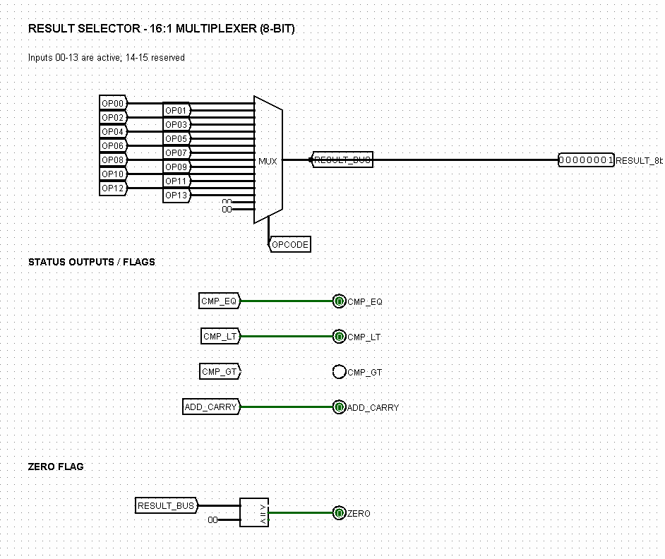
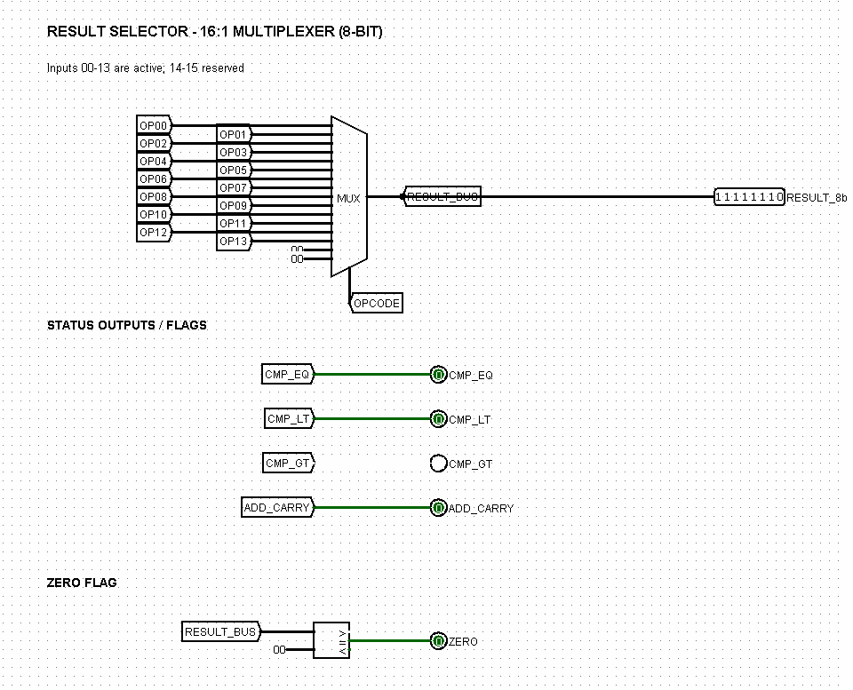
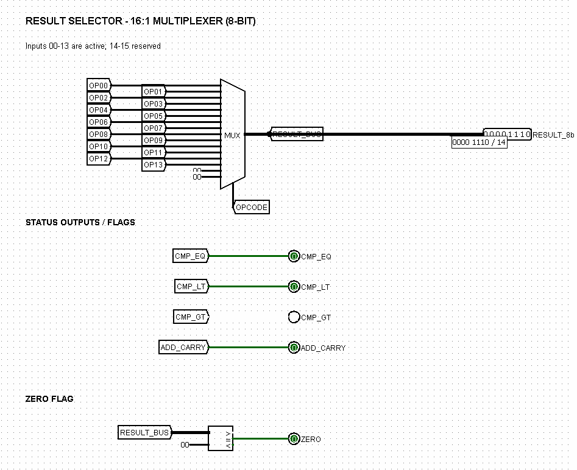

# 8 Bit CPU and ALU in Logisim

A digital logic project that shows how a small processor datapath stores numbers, performs operations, and handles results. I used Logisim to work with registers, an ALU, control signals, and status flags so I could see how these parts work together.

## Scenario

I wanted to understand what happens inside a computer when it processes data. I used Logisim to work with a small circuit where I could watch numbers enter registers, go through different operations, and come out as results. I also wanted to see what happens when I change the controls and how the circuit stores information.

## Design Requirements

The circuit needed to:

* Hold two 8 bit values in separate registers
* Perform 14 arithmetic and logic operations
* Select an operation with a 4 bit opcode
* Show the selected result as an 8 bit value
* Keep stored values when loading is disabled
* Clear the registers with reset
* Save an ALU result back into Register A
* Show carry, zero, and comparison flags

## Circuit Design

| Part | Purpose |
| --- | --- |
| Register A | Stores the first number and can accept a saved ALU result |
| Register B | Stores the second number |
| ALU | Performs math, logic, and shift operations |
| Opcode input | Chooses which operation to use |
| Result MUX | Sends the selected ALU output to the result bus |
| Clock and load controls | Decide when register values change |
| Status flags | Show zero, carry, and comparison conditions |

The 14 ALU outputs connect to a 16 input MUX. The two remaining opcode choices are reserved.

## Design Choices

**Clocked registers**

I used separate load controls for Registers A and B. A register only takes a new value when loading is enabled and the clock rises. This makes it possible to test whether stored values stay in place.

**Opcode selection**

I used a 4 bit opcode so each operation could have its own number. The MUX chooses one result without needing to change the wiring for every test.

**Result write back**

I added a way to send the ALU result back into Register A. I kept this separate from the load control so selecting write back alone does not overwrite a value. The register still needs a clock edge to save it.

**Status flags**

I added flags to see when an answer is zero, when addition produces a carry, and how the two stored numbers compare. These outputs make it easier to understand what the circuit is doing.

## Operations

| Opcode | Operation | Action |
| --- | --- | --- |
| `0000` | ADD | A plus B |
| `0001` | INC | A plus 1 |
| `0010` | DEC | A minus 1 |
| `0011` | CMP | Compares A and B |
| `0100` | NOT | Flips the bits in A |
| `0101` | AND | Bitwise AND |
| `0110` | OR | Bitwise OR |
| `0111` | SHR | Shifts A right by 1 |
| `1000` | SHL | Shifts A left by 1 |
| `1001` | SUB | A minus B |
| `1010` | XOR | Bitwise XOR |
| `1011` | NAND | Bitwise NAND |
| `1100` | NOR | Bitwise NOR |
| `1101` | XNOR | Bitwise XNOR |
| `1110` | Reserved | Not implemented |
| `1111` | Reserved | Not implemented |

For CMP, the result bus shows A, while the comparison flags show whether A is equal to, less than, or greater than B.

## Implementation

I worked with two clocked 8 bit registers, built the operation circuits, and connected their outputs to the result MUX. I also connected the opcode input, control indicators, and status flags. The final wiring layout uses short, straight connections into the result MUX so the circuit is easier to follow.

The editable Logisim file is available in the [circuit folder](circuit/8-bit-cpu-alu.circ).

## Validation

I went through 21 manual checks in Logisim. All 14 ALU operations passed with Register A set to 3 and Register B set to 2. I also checked register loading, holding values, reset, write back, the zero and carry flags, and the comparison flags.

One test found a problem with the shift direction. I corrected that setting and retested both shift operations successfully. After shortening and straightening the MUX wires, I reran all 21 tests on that final layout, and all 21 passed. I also captured screenshots during the final tests for SHR, XNOR, and write back.

[Read the test results](docs/TESTING.md)

## Final Test Screenshots

These screenshots were captured while manually retesting the final straight-wire MUX circuit in Logisim 2.7.1.

**SHR (opcode `0111`):** Register A = 3, Register B = 2, selected result `00000001` (1), and `CMP_GT` active.

**XNOR (opcode `1101`):** Register A = 3, Register B = 2, selected result `11111110` (254), and `CMP_GT` active.

**Register writeback:** Register A = 9, Register B = 5, selected ADD result `00001110` (14) after storing the previous sum of 9 back into Register A.

All 21 manual tests passed on the final straight-wire layout. The screenshots show selected checkpoints, not every test.

## Purpose and What I Learned

I wanted to go beyond knowing that computers process information and understand how some of that work happens inside the hardware. This circuit helped me see how registers store values, how a clock controls when information changes, and how an opcode tells the ALU which operation to perform. I also learned why each connection and setting matters, especially when a shift operation gave the wrong result and I had to find the cause. Testing the circuit helped me understand how to check a system one part at a time instead of assuming everything works because it looks correct. These are useful foundations for understanding larger computing systems and the hardware that supports them.

## Current Limitations

This is a CPU datapath, not a complete programmable CPU. It does not include instruction memory, a program counter, or an instruction fetch cycle. Two opcode values are reserved. The manual tests cover selected values and edge cases, not every possible input combination. The final straight-wire layout passed all 21 planned manual tests in Logisim.

## Next Steps

I can improve this project by adding more test cases, documenting more input combinations, and adding clear screenshots of the final circuit. A larger version could also include instruction memory and a program counter.

## Project Files

* [Logisim circuit](circuit/8-bit-cpu-alu.circ)
* [Circuit explanation](docs/ARCHITECTURE.md)
* [Testing record](docs/TESTING.md)
* [Test screenshots](screenshots/)
